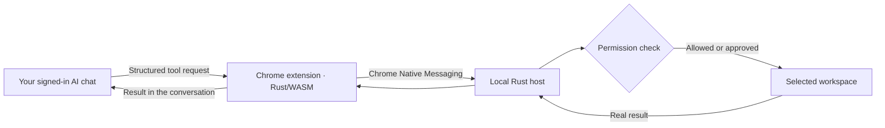

# Unified AI Bridge

**Give the AI chats you already use a guarded connection to your Mac.**


[](LICENSE)

You ask a web chat to update a document. It writes a useful answer. Then you still have to copy the answer, find the file, paste it, and check what changed.

Unified AI Bridge closes that gap. A Chrome extension connects your normal, signed-in AI chats to a local Rust host. The chat can request tools to read files, search a folder, make edits, and run commands you have explicitly allowed. The host checks the request, performs the operation, and returns the real result to the same conversation.

No provider API keys. No separate AI subscription from this project. Your provider's normal account limits still apply.

> **Early access · 0.5.21 candidate; last live provider verification 0.5.7** — This is a working developer project, with live file operations verified on several providers. It is not yet a one-click installer or a promise that every website layout works. See [provider status](#provider-status) and [verification](docs/VERIFICATION.md).

## What you can do

- **Work on ordinary folders.** Read, search, create, edit, append, copy, compare, and organize text files. Batch reads, glob matching, and file trees keep larger tasks manageable.
- **Bring downloaded chat files into a project.** Select a completed Chrome download, share it with one conversation, then approve a copy into the workspace. Images, PDFs, ZIPs and other files retain their bytes; imports check hashes and refuse overwrites. [How browser files work](docs/BROWSER-FILES.md).
- **Package and unpack selected files.** Inspect a bounded ZIP, approve extraction into a new folder, or create a ZIP from an explicit file list. Path checks, hashes and CRC validation protect the operation; contents are never run. [Supported ZIP subset](docs/ARCHIVES.md).
- **Inspect and transform image files.** Read PNG/JPEG/WebP metadata and make a new resized, cropped, rotated or converted copy after approval. Originals stay intact; unsupported features are refused explicitly. [Image limits](docs/IMAGES.md).
- **Review and recover edits.** Preview single-file or [multi-file changes](docs/PATCHES.md), check hashes before overwriting, inspect recovery receipts, and request a restore. Deletion moves files to workspace trash and requires approval.
- **Recover larger files (0.5.8 candidate).** Approved replacements and trash/restore support files up to 64 MiB, with private snapshots, storage limits and manual cleanup. Native checks passed; the new browser controls still need live acceptance. [Recovery behavior and limits](docs/BINARY-RECOVERY.md).
- **Navigate source code (0.5.9 candidate).** Page through bounded text matches, list Rust syntax declarations, and follow supported compiler diagnostics to their source lines. Semantic references and live UI acceptance remain pending. [Code navigation](docs/CODE-NAVIGATION.md).
- **Review and commit local changes (0.5.11 candidate).** Inspect Git status, diffs and history. Preview selected working files and approve a commit on a new branch while preserving your current branch, staging area and unrelated edits. Native checks passed; live UI acceptance remains pending. [Git behavior and limits](docs/GIT.md).
- **Read and query tables (0.5.12 candidate).** Page through CSV/TSV files, select columns, filter records and calculate bounded numeric summaries. Values stay data; formulas are never executed. XLSX uses the separate workbook tools below; browser acceptance remains pending. [Table support](docs/TABLES.md).
- **Read and edit simple spreadsheets (0.5.16 candidate).** Inspect XLSX sheets, read cell ranges and approve a copy with changed literal cells. Originals, styles and untouched content are preserved. Formula recalculation and complex workbook edits are refused. [Workbook limits](docs/WORKBOOKS.md).
- **Read documents and preview PDF pages (0.5.15 candidate).** Extract DOCX body text or PDF embedded text with page references on macOS. Save approved PDF page previews as new PNG files. Encrypted PDFs, Word rendering and chat image delivery remain unavailable; local PNG OCR is a separate tool below. [Document subsets](docs/DOCUMENTS.md).
- **Create a PDF report (0.5.19 candidate).** Supply a title, headings, paragraphs and bullets, then approve a new PDF with embedded fonts and numbered pages. Native creation, read-back and render checks are separate from live browser acceptance. DOCX, slides and richer layout remain pending. [Report format and limits](docs/DOCUMENT-CREATION.md).
- **Inspect and trim PCM WAV audio (0.5.20 candidate).** Read format/duration and approve a new file containing an exact frame range. Original samples are preserved; unsupported metadata and formats are refused. Playback, transcription, video and chat audio delivery remain pending. [Audio subset](docs/MEDIA.md).
- **Read text in a PNG (0.5.21 candidate).** Run local fast English OCR on macOS, including saved PDF page previews. Results include text boxes and confidence but can contain recognition mistakes. No image is sent to a website. [OCR boundaries](docs/OCR.md).
- **Use your own project commands.** Grant a specific executable, arguments, working directory, timeout, and output limit. The chat selects an allowed command; it cannot invent a shell command.
- **Switch workspaces from the panel.** Choose a folder or enter its path, select a profile, and send updated workspace context to connected chats. Lock a workspace when you want read-only access.
- **See what happened.** Inspect sessions, pending approvals, tool results, activity, and a hash-chained audit log. A direct tool runner lets you exercise the host without prompting a model.
- **Connect reviewed native MCP tools.** Register a local native executable, discover its tools, and explicitly grant access. Each call requires approval. The 0.5.14 candidate adds readiness checks and stops active process groups when grants are removed or the workspace locks. [Integration limits](docs/INTEGRATIONS.md).
- **Run bounded background work.** Approved commands can keep running through a browser reconnect. Inspect saved output, stop jobs, and grant a selected session time-limited file writes with budgets. See [overnight controls](docs/OVERNIGHT.md).
- **Pause a chat's local calls (0.5.17 candidate).** Keep task budgets and receipts across host restarts, block new calls, close waiting approvals and save a private task report. Already executing work may finish; background commands have separate Stop controls. Resume does not restart the model or replay an old write. [Task controls and limits](docs/OVERNIGHT.md#chat-task-controls-0517-candidate).
- **Read public pages and download files (0.5.18 candidate).** Grant selected public origins, then approve an anonymous GET. Return bounded text or save a new file with a verified hash. Network access starts off; private addresses, login cookies, query strings and overwrites are refused. [Network scope and limits](docs/NETWORK.md).
- **Inspect the desktop.** Capture screenshots to files, list open applications, and inspect accessible windows, subject to macOS permissions. Mouse and keyboard control are still planned.

For example, in a **general** workspace:

> “Read the notes in `notes/`, draft a short project brief in `output/brief.md`, then read it back and tell me what you saved.”

Or, in a **code** workspace:

> “Find the configuration parser, propose a small fix, and run the test command I've approved for this project.”

These requests still depend on the model following the tool protocol. A successful tool result comes from the local host, not from the model saying it finished.

## How it works



The extension reads the visible conversation. It recognizes strict `[[BRIDGE_TOOL]]` blocks or supported code-block forms, then forwards them through Chrome Native Messaging. The host assigns the session identity; a model cannot choose to act as another provider.

The implementation is Rust throughout: **Oxichrome** generates the extension package, **Leptos** renders the controls, **Tokio** drives the host, **Serde** handles messages, **RMCP** handles MCP, and **SQLite** stores state and audit records. JavaScript/HTML glue is generated during the build; there are no maintained JavaScript, TypeScript, or CSS source files.

## Provider status

“Verified” below means a real website conversation reached the host, created a file, and received the result. It does not mean every tool or account configuration has been tested.

| Website | What has been verified | Notes |
| --- | --- | --- |
| ChatGPT | Read → create → read-back; approved patch; draft-safe result delivery | 0.5.7; navigation/background also checked on 0.5.6. An incomplete model reply needed a corrected task |
| Claude | Read → create → read-back; approved patch; navigation/background | 0.5.7 fixes hidden announcement extraction; use fenced `bridge-tool` JSON to preserve quotes |
| DeepSeek | Read → create → read-back; approved patch | 0.5.7; navigation/background also checked on 0.5.6 |
| Gemini | Read → create → read-back; approved patch | 0.5.7; navigation/background also checked on 0.5.6 |
| Grok (`grok.com`) | Connected on 0.5.6 | Website's free-tier limit blocked the current file loop |
| Grok on X | Read → create → read-back; approved patch | 0.5.7; navigation/background also checked on 0.5.6 |
| Qwen | Read → create → read-back; approved patch | 0.5.7; needed foreground rendering and a choice between candidate answers |
| Kimi | Read → create → read-back; approved patch; earlier generated SVG import | General loop on 0.5.7; artifact import on 0.5.0 |

Qwen sometimes hides rendered message text in background tabs. Its session stays connected, but tool execution may wait until you bring the tab into view. All adapters depend on website markup and can need updates when a provider changes its interface.

## Run it locally

You need **macOS, Google Chrome, Rust installed through rustup, and the Xcode Command Line Tools**. Use the current stable Rust toolchain. The recorded development build used Rust 1.99.1 on Apple Silicon; Intel hardware and the minimum supported macOS version still need physical testing. Windows and Linux installation are not supported yet.

### 1. Get the source and build tools

```sh
git clone https://github.com/mrfentmen/unified-ai-bridge.git
cd unified-ai-bridge

rustup toolchain install stable
rustup target add --toolchain stable wasm32-unknown-unknown
export PATH="$HOME/.cargo/bin:$PATH"

cargo +stable install --locked \
  --git https://github.com/0xsouravm/oxichrome \
  --rev f36ed22c007541e47308904ee925e21aa544e431 \
  cargo-oxichrome
```

Oxichrome obtains the `wasm-bindgen` CLI version matching the lockfile when needed. The first build can take a while.

### 2. Initialize a scratch workspace, then deploy

```sh
cargo +stable run --locked -p bridge-native -- setup \
  --project "$HOME/Bridge Workspaces/bootstrap"

cargo +stable bridge-deploy
```

The setup command currently initializes the **research** profile and adds its folder skeleton. Start with a dedicated scratch folder. After connecting, use **Workspace controls** to choose your actual folder with the **general** or **code** profile.

`bridge-deploy` pins Cargo and rustc to the active rustup toolchain, rebuilds the extension, checks that package versions agree, installs the native host, and verifies Chrome's native-host manifest. It fails if the WASM target is missing or the generated build is stale. See [deployment details](packaging/DEPLOY.md) if Homebrew's Rust and rustup are both installed.

### 3. Load the extension in Chrome

1. Open `chrome://extensions` and enable **Developer mode**.
2. Click **Load unpacked** and select `crates/bridge-extension/dist/chromium` inside this checkout.
3. If this is the first native-host installation, fully quit and reopen Chrome. Reopen the provider tabs you want to use.
4. Open a supported AI website and sign in normally. Check that the bridge panel shows the workspace, a session ID, and matching extension/host versions.
5. Use **Inject tool instructions** if the chat has not connected automatically. Then give it an explicit task.

The extension stays unpacked during development. After later builds, click its **Reload** button and refresh your provider tabs. A successful build on disk does not update Chrome's already-loaded copy.

### 4. Choose your workspace

Open the extension popup or side panel, expand **Workspace controls**, choose a folder or type its path, and select a profile:

| Profile | Intended use |
| --- | --- |
| `general` | Documents, notes, and everyday files. Adds `notes/`, `files/`, `output/`, and `.bridge/`. |
| `code` | Source repositories, documentation, tests, and explicitly allowed project commands. Protects `.git/` internals. |
| `research` | The original research workflow: per-agent folders, shared findings, collaboration tools, and immutable datasets. |

Click **Create / use folder**. Structure creation is additive; it does not move or replace your existing files. Switching is audited and sends updated workspace instructions to connected chats. Pending calls keep their original workspace.

## Permissions and privacy

The native file tools are confined to the selected workspace. Paths are checked after canonicalization; traversal and symlink escapes are rejected. Private-file patterns exclude common credential files. Existing-file edits require the hash from a recent read, and deletes require approval.

**Strict** mode asks for approval on writes. **Standard** allows ordinary writes inside the workspace. **Trusted** is available, but does not remove path checks, protected-file rules, or delete approvals. Read-only locking rejects writes.

Allowed commands and external MCP programs run with your macOS account's OS permissions. A workspace-relative working directory is **not an operating-system sandbox**. Only grant programs you trust; project test/build commands can themselves execute project code.

“Local” describes where the tools run and where bridge state is stored. **File contents returned to the chat are sent to that AI website.** Choose folders and requests accordingly. The bridge does not extract cookies, call hidden provider endpoints, or bypass sign-in or usage limits.

macOS may ask for folder, Screen Recording, or Accessibility access. Rebuilding an unsigned native host can trigger a fresh folder-access prompt. Grant only the access you intend to use; rebuilding does not make those OS permission requirements disappear.

## Checks and troubleshooting

```sh
cargo +stable run --locked -p bridge-tooling -- icons
cargo +stable test --workspace --locked
cargo +stable run --locked -p bridge-native -- selftest

"$HOME/Library/Application Support/unified-ai-bridge/bin/unified-ai-bridge-native" doctor
```

`selftest` uses a temporary workspace and removes it afterward. `doctor` checks configuration, the installed binary, native messaging registration, SQLite integrity, and the audit chain.

If a panel looks disconnected, first compare its build number with the extension card in `chrome://extensions`. Then check:

```text
~/Library/Application Support/unified-ai-bridge/logs/native-host.log
```

If the composer contains your draft, the bridge leaves it alone. Finish or save that draft before sending a pending result. A selector warning means the website layout needs attention; it is not a reason to broaden file permissions.

The 0.5.3 local checks passed **104 workspace tests and 41 host self-tests**, plus a separate 249.6-second Cargo job, real host restart recovery, and live panel cancellation/keep-awake/report checks. Kimi’s generated-file import remains verified on 0.5.0; its newest conversation test was blocked by website capacity. [GitHub CI](https://github.com/mrfentmen/unified-ai-bridge/actions/workflows/ci.yml) repeats automated checks and packaging on clean runners. Details and boundaries are in [VERIFICATION.md](docs/VERIFICATION.md).

## Project layout

```text
crates/bridge-core/        Protocol, providers, tool catalog, workspace profiles
crates/bridge-native/      Local tools, permissions, audit, Native Messaging, MCP
crates/bridge-extension/   Rust/WASM adapters and Leptos controls
crates/bridge-tooling/     Packaging, generated icons, deterministic deployment
packaging/                Deployment guide and public extension identity
docs/                     Verification and next steps
```

## Where this is going

The aim is a dependable local toolbox for normal web chats: documents, coding, research, and eventually application workflows. The next work is unattended-job reliability, stronger approval/recovery acceptance, longer-running commands, and reviewed integrations. Desktop input, rich document editing, and general web-fetch tools are **not shipped features**. See the [plan](docs/PLAN.md) and [24-task backlog](docs/TASKS.md) for proposed tools and completion checks.

This project takes inspiration from [ZeroScript Free](https://github.com/sebattfg/ZeroScript-Free) and other local-tool projects. Their behavior helped inform the design; their source was not copied into this Rust implementation.

Found a broken adapter? Please open an issue with the website, bridge version, the panel's exact error, and a small reproduction. Remove file contents, private paths, conversation URLs, session IDs, and credentials from diagnostics before posting them.

## License

[MIT](LICENSE). Dependencies retain their own licenses.
